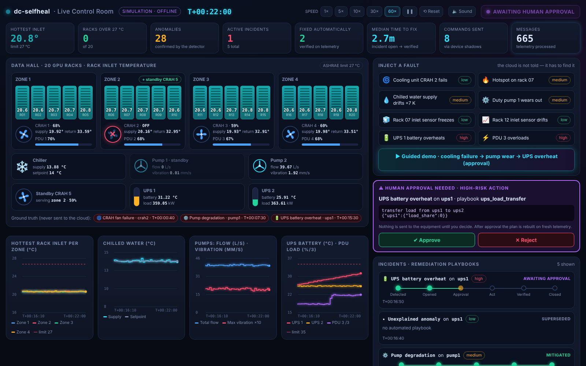

# Live control-room dashboard

One page that shows the whole framework working: the data hall as a floor plan (rack inlet
temperatures as a heatmap, cooling-unit fans and pumps that spin with their real speed, UPS
batteries, PDU loads), trend charts, every anomaly the detector confirms, every incident with its
playbook timeline (detected → opened → approval → act → verified → closed), the commands sent through
the device shadows and the emails sent to people. High-risk plans appear as an approval card with
Approve / Reject buttons.



It runs in three places with the same page:

| Command | Data | Faults come from |
| --- | --- | --- |
| `make dashboard` | Offline simulation: the simulator, detector, state machine and the real Lambda handlers in one process (mocked AWS), paced to wall-clock time | Buttons on the page (or the guided demo) |
| `make dashboard-local` | The LocalStack stack (`make deploy-local`, `make pipeline-up`) | `python -m simulator.live --scenario …` |
| `make dashboard-aws` | The stack on AWS (`make aws-deploy`) | `python -m simulator.live --aws-certs certs --scenario …` |

Open <http://localhost:8080>. Stop with Ctrl-C.

## Offline simulation (no AWS, no cost)

```bash
make dashboard                 # speed x10: one simulated minute every 6 seconds
make dashboard DASH_SPEED=5    # slower, better for explaining each step
```

- **Inject a fault**: eight buttons, one per fault type, with the same fault definitions as the
  experiments. The cloud side is not told: the detector has to find the fault from telemetry. The
  injected faults are listed under *Ground truth*, which never reaches the detector.
- **Guided demo**: a CRAH failure now, pump wear 7 minutes later and a UPS overheat 15 minutes later
  (simulated time). The first two are fixed and verified with no human input; the third waits for
  you to approve it.
- **Speed** 1× to 60×, **pause**, and **reset** (a fresh hall).
- **Sound**: a short tone when an incident opens, is mitigated, or needs approval.

The simulation is the offline closed loop of the experiments (`experiments/closed_loop.py`), so what
the page shows is what the experiments measured.

## A deployed stack (LocalStack or AWS)

The dashboard polls the tables the pipeline already writes: the newest telemetry message of each
gateway, the Detections table, the Incidents table (summaries, audit trails, approvals) and the
IngestStats table (pipeline latency). A poll every 3 s costs a few cents a day with on-demand tables.
Approve / Reject goes through the approval Lambda with the same one-time nonce checks as the email link.

```bash
make dashboard-aws                                            # terminal 1
.venv/bin/python -m simulator.live --aws-certs certs --speed 5 \
  --scenario simulator/scenarios/e2e_crah_failure.yaml        # terminal 2: CRAH 2 fails after 1 minute
```

`e2e_ups_overheat.yaml` shows the approval flow. Run `python -m tools.prepare_run --stage dev` (with
the AWS profile, see [aws.md](aws.md)) between demos so old locks do not group a new fault into an
earlier incident.

## On an EC2 instance or a remote server

The page can approve high-risk actions, so it only listens on localhost unless asked otherwise.
With `HOST=0.0.0.0` it prints a URL with a random access token; without the token every request is
refused.

```bash
make dashboard-aws HOST=0.0.0.0
#   dashboard: http://localhost:8080/?token=…   -> use the instance's public IP instead of localhost
```

Allow port 8080 in the instance's security group **for your own IP only** (EC2 → Security Groups →
Inbound rules → Custom TCP 8080, source *My IP*), and remove the rule after the demo. Alternatively,
keep the port closed and forward it with Session Manager from your laptop:

```bash
aws ssm start-session --target <instance-id> --document-name AWS-StartPortForwardingSession \
  --parameters portNumber=8080,localPortNumber=8080
```

## Files

| File | What it does |
| --- | --- |
| `dashboard/core.py` | The snapshot behind the page: gateways, trends, anomalies, incidents, approvals, KPIs |
| `dashboard/sim.py` | Offline source: the closed loop with live fault injection, approvals, speed and pause |
| `dashboard/aws.py` | Deployed-stack source: polls DynamoDB, decides approvals through the approval Lambda |
| `dashboard/server.py` | Standard-library HTTP server with the optional access token |
| `dashboard/static/index.html` | The page (no external libraries) |
| `tests/test_dashboard.py` | Snapshot, simulation, AWS source (moto) and server tests |
