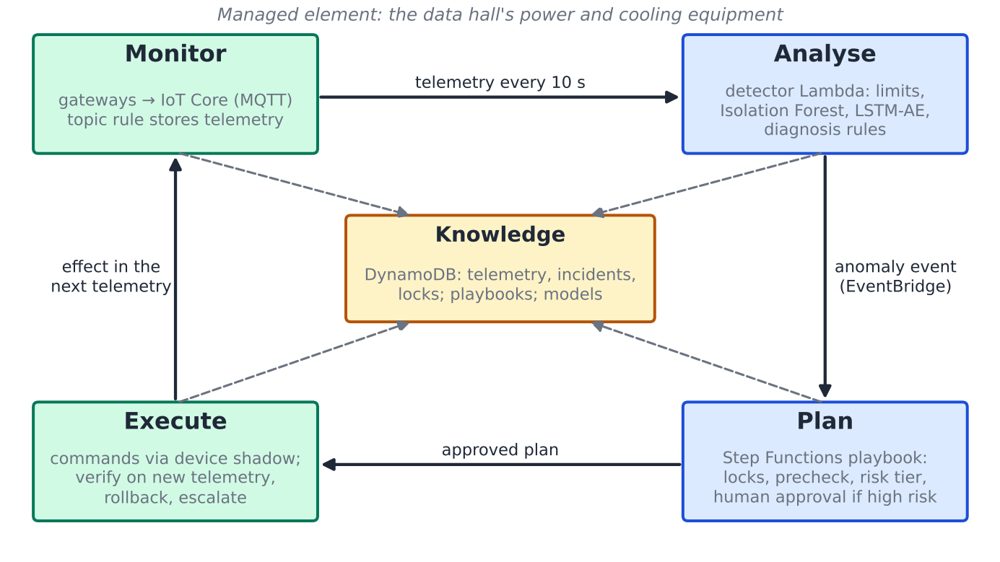

# Anomaly detection and self-healing systems

The chapter will form the theoretical basis of detection and automated remediation.

## Faults, errors and anomalies

The concepts of dependability (fault, error, failure) and the types of anomalies in time series will be defined.

## Threshold-based detection

Static limits will be described as the industry baseline, with their strengths and their weaknesses for slowly developing faults.

## Machine-learning detectors

Isolation Forest and LSTM autoencoders will be presented as lightweight detectors that can be trained on normal data only and run inside a Lambda function.

## Evaluating anomaly detectors

Metrics such as precision, recall, F1, time to detect and false alarm rate will be discussed, together with known problems of public benchmarks.

## Self-healing and autonomic computing

The MAPE-K loop and earlier self-healing frameworks will be reviewed. Figure 1 shows how the loop will be mapped to the planned framework.

Figure 1. The MAPE-K loop of autonomic computing mapped to the planned framework (adapted from Kephart & Chess 2003)

## Safe automation of physical equipment

Levels of automation, risk tiers, circuit breakers, rate limits and human approval will be discussed as the basis of the guardrails.

## Related work and research gap

The closest studies will be compared in a table, and the research gap will be stated: no earlier work combines serverless cloud IoT, machine-learning detection and guarded automatic remediation for facility equipment with a controlled evaluation.
