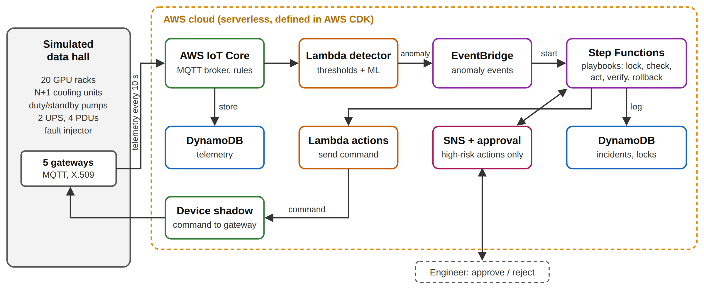

# Implementation

The chapter will describe the framework as it will be built. Figure 2 shows the planned architecture.

## Overall architecture

Gateways will publish telemetry over MQTT to AWS IoT Core. A topic rule will store every message in DynamoDB and invoke the detector function. Confirmed anomalies will be sent to an EventBridge bus, which starts a remediation workflow in Step Functions. Commands will be sent back to the gateways through device shadows, and people will be notified through SNS.

Figure 2. Planned serverless architecture of the framework

## Simulated data hall

A simulator of a data hall with 20 GPU racks in four zones, CRAH units with a standby unit, pumps, a chiller, two UPS units and four PDUs will be implemented.

## Fault injection

Eight fault types will be defined, among them a CRAH fan failure, pump wear, chilled-water drift, a rack hotspot, a PDU overload, UPS battery overheating and faulty sensors.

## Telemetry pipeline

The ingestion path from the gateways to the detector and the storage of telemetry will be described.

## Detection

Static limits, Isolation Forest, an LSTM autoencoder and hybrid versions with diagnosis rules will be implemented and exported so that they run inside Lambda.

## Remediation playbooks

One generic Step Functions state machine will run playbooks that are defined as data, for example cooling failover and UPS load transfer.

## Guardrails

Asset locks, risk tiers, human approval with a one-time link, a recheck before acting, verification, rollback, a circuit breaker and a rate limit will be implemented.

## Offline closed loop and testing

An offline closed loop with mocked AWS services will be built so that hundreds of experiment runs can be made quickly, and the code will be covered by unit tests.

## Deployment on AWS and live dashboard

The stacks will be deployed to AWS with the CDK, and a live control-room dashboard will be built to follow incidents and approve high-risk actions.
