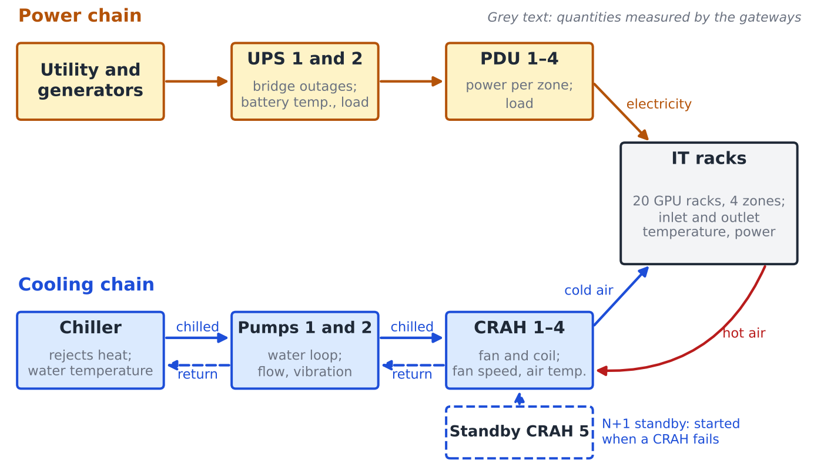

# Data center facility operations

This chapter describes the physical infrastructure that the framework monitors, the limits within which it must operate, and the way faults in it are handled today. Together these define the problem that the rest of the thesis addresses.

## Power and cooling infrastructure

A data center consists of two layers. The IT layer contains servers, storage and network equipment. The facility layer contains everything that keeps the IT layer running: the power chain that delivers clean, uninterrupted electricity, and the cooling system that removes the heat the IT equipment produces. Practically all electrical energy consumed by servers is converted into heat, so the two systems are tightly coupled: every kilowatt delivered to a rack is a kilowatt that the cooling system must remove. (Barroso, Hölzle & Ranganathan 2018.)

The power chain starts at the utility connection and on-site generators. An uninterruptible power supply (UPS) bridges the seconds between a utility failure and generator start-up, usually with batteries, and conditions the power delivered to the IT load. Power distribution units (PDU) then distribute the power to the racks. Each element has a rated capacity, and an element running close to its limit leaves no margin for a load surge. Batteries are a specific concern because their temperature affects both their lifetime and their safety; a battery that heats abnormally is an early warning sign of failure. (Barroso et al. 2018.)

The cooling system typically has two stages. Computer room air handlers (CRAH) blow cool air through the IT equipment and return the heated air over cooling coils. The coils are fed with chilled water that pumps circulate from a chiller plant, where the heat is finally rejected to the outside. Fan speed, supply air temperature, chilled-water temperature and water flow therefore all determine how well a rack is cooled. Pumps and fans are rotating machines that wear gradually; rising vibration and motor current at a given flow are classic signs of mechanical degradation (ISO 10816-3 2009).

Figure 1 shows the two chains as they are modelled in the simulated data hall of this thesis, together with the quantities that its gateways measure. Electricity flows from the utility through the UPS and the PDUs to the racks; heat flows back from the racks through the air to the CRAH units and through the chilled-water loop to the chiller.

Figure 1. Power and cooling chains of a data hall and the quantities measured in the simulated hall

Critical equipment is normally installed with redundancy. N+1 redundancy means that one more unit than the load requires is available, so that a single failure can be absorbed by a standby unit. Redundancy does not remove the need to act, however: the standby unit must be started, or the remaining units must increase their output, and the failed unit must be repaired before a second failure occurs. Whether this happens in seconds or tens of minutes is a question of operations rather than design.

## Thermal limits and the growth of dense racks

The environmental conditions for IT equipment are commonly specified by the ASHRAE Technical Committee 9.9. Its thermal guidelines define a recommended envelope for server inlet air temperature of 18–27 °C, with wider allowable ranges for short periods depending on the equipment class (ASHRAE TC 9.9 2021). The upper limit of 27 °C is widely used as an alarm threshold for rack inlet temperatures, and it is also used for that purpose in this thesis.

Heat density is increasing quickly. The International Energy Agency estimates that data centers consumed about 415 TWh of electricity in 2024, around 1.5 % of global electricity use, and that this could more than double by 2030, largely because of accelerated servers for artificial intelligence (IEA 2025). In the United States, data centers already used about 4.4 % of all electricity in 2023 (Shehabi et al. 2024). GPU servers draw several times the power of conventional servers, so a single rack can produce tens of kilowatts of heat. In such a rack, the inlet temperature can rise above the recommended limit within a minute of losing airflow, and the processors protect themselves by throttling their clock speed, which slows down the workload, or by shutting down.

## Outages and their causes

Uptime Institute's annual outage analysis tracks the frequency, causes and cost of data center outages. Its 2026 analysis reports that the frequency of outages per site has decreased for several years, while their cost keeps increasing: 57 % of operators said their most recent significant outage cost more than $100,000, and about one in five said it cost more than $1 million. Power problems, dominated by failures of UPS systems, transfer switches and generators, remain the leading cause of impactful outages. The analysis also notes that operators are increasing investment in automation and control systems to manage the growing complexity of their facilities. (Uptime Institute 2026.)

Human factors are an important part of the picture. Many outages involve an operator who did not follow a procedure, a procedure that was incomplete, or a response that came too late (Uptime Institute 2026). A fault in itself rarely causes an outage; an outage happens when a fault is not contained in time. This observation is the starting point of this thesis: the time between a fault and its correction is the quantity that automation can change.

## Monitoring and manual response

Facility equipment is monitored through a building management system or a DCIM tool, which collects readings from sensors and equipment controllers, displays them, and raises alarms. The prevailing alarm logic is a fixed threshold per measurement: an alarm is raised when, for example, a rack inlet temperature exceeds 27 °C or a PDU load exceeds 90 % of its rating. Static thresholds are simple, transparent and easy to audit, which explains their popularity. Their weaknesses are equally well known. A threshold set low enough to catch a slow drift raises false alarms during normal load swings, and a threshold set high enough to avoid false alarms detects a slow drift only when it is already harmful. (Huang et al. 2019.)

After an alarm, the response depends on people. An operator must notice the alarm, diagnose its cause, decide on an action, and carry it out through the management system or on site. Each of these steps takes time, and the time varies with staffing, workload and the clarity of the alarm. Studies of monitoring data from large data centers describe the volume and heterogeneity of the data as a main difficulty in recognising the anomalies that matter (Viola et al. 2022; Ronchieri et al. 2024).

Automation has long been proposed as an answer, but automation on physical equipment carries its own risk. Bainbridge (1983) described the "ironies of automation": the more a system is automated, the less practice operators have in handling it, yet they are expected to take over exactly when the automation fails. Any automation of facility operations must therefore be designed so that people remain in control of high-risk decisions and can see and understand what the automation has done. These requirements are developed further in Chapter 4.
