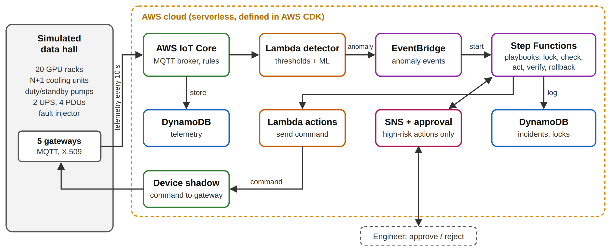
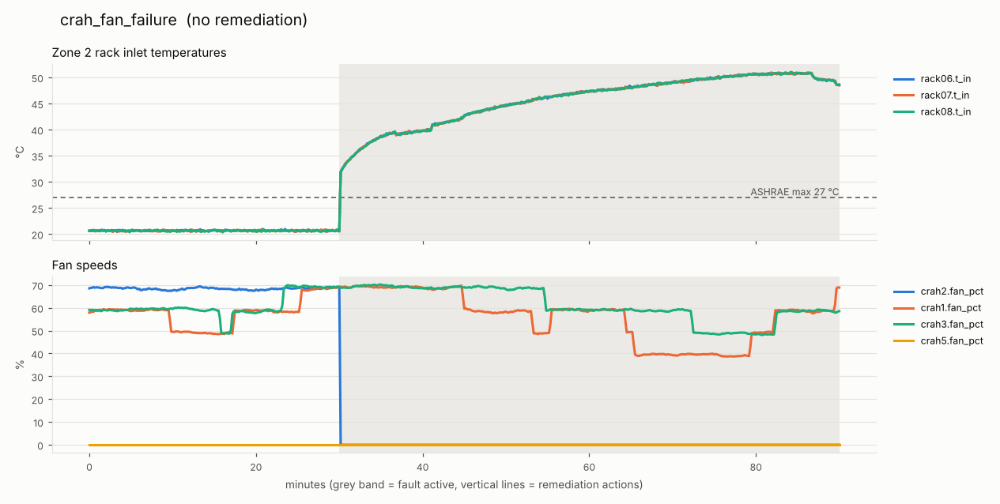
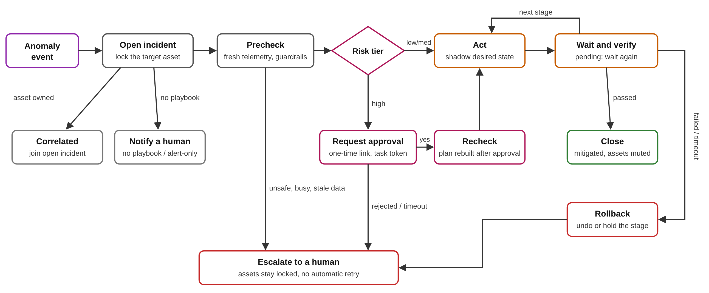
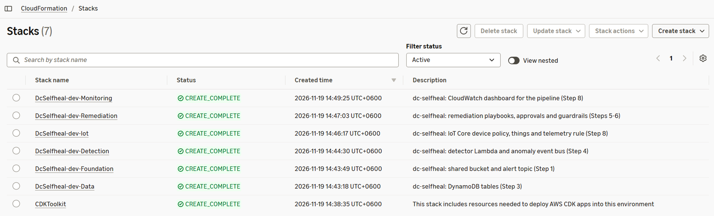
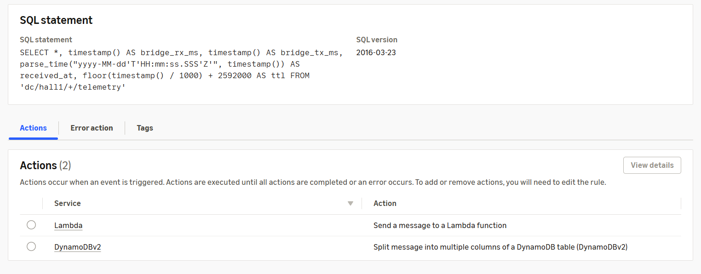
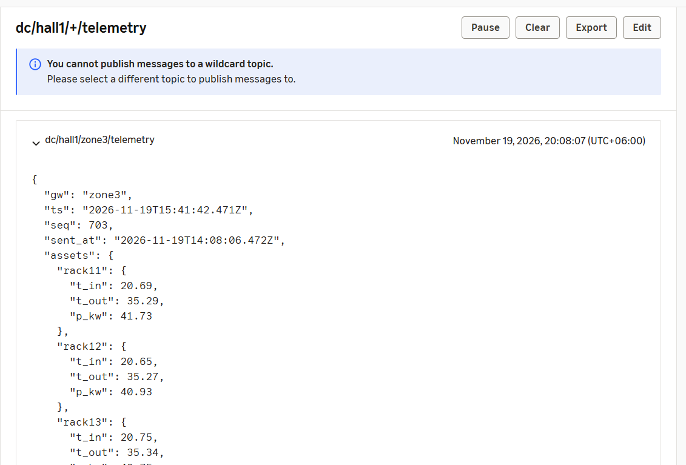
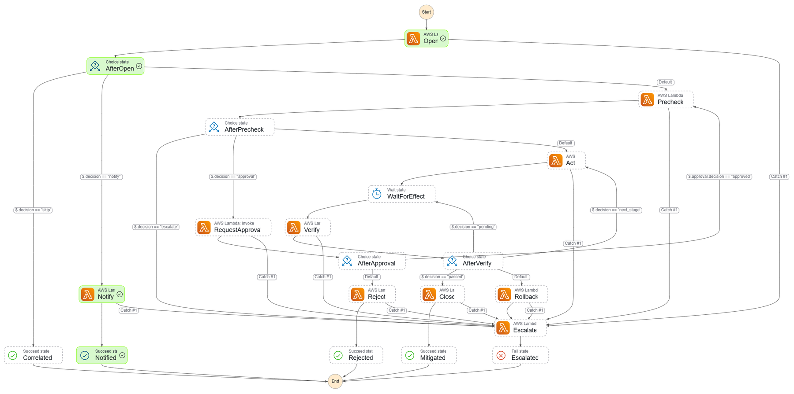
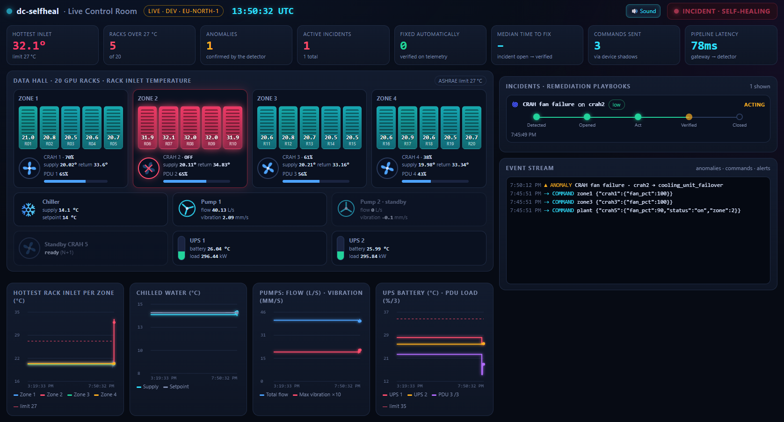
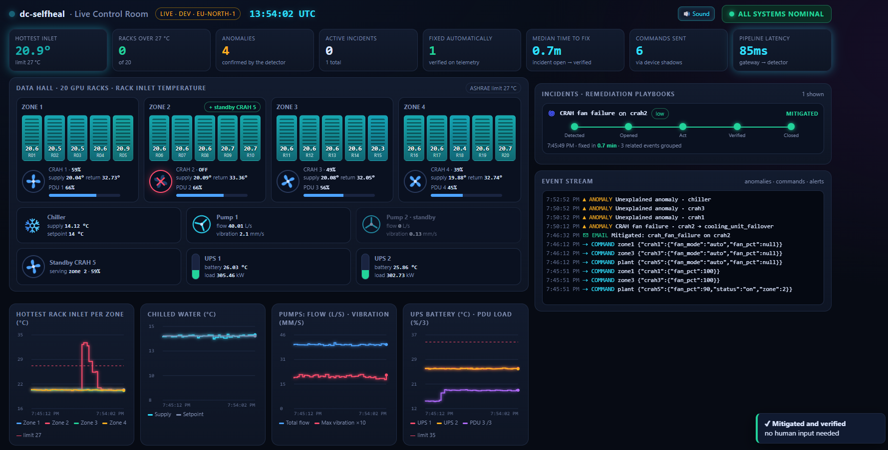
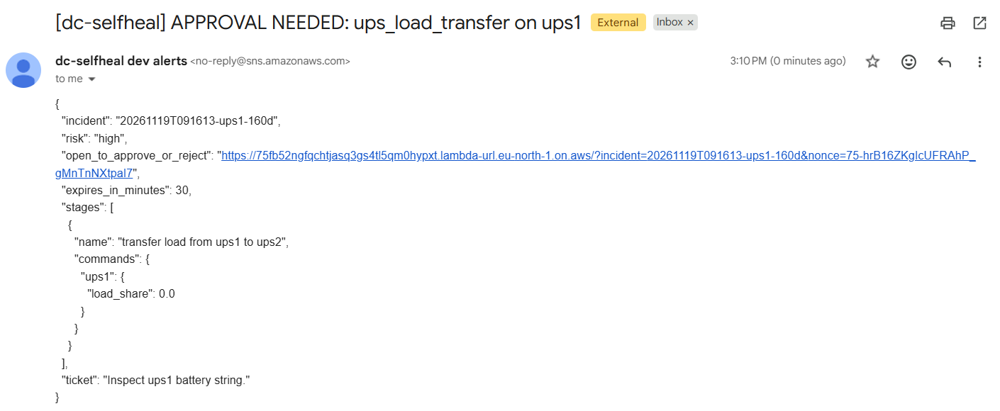

# Implementation

This chapter describes the framework that was built: its overall architecture, the simulated data hall and its faults, the telemetry pipeline, the detection layer, the remediation playbooks and guardrails, the way the system was tested, and its deployment on AWS with the live control-room dashboard. The source code, about 8,000 lines of Python excluding tests, is published in a public Git repository.

## Overall architecture

The framework was designed as a serverless, event-driven system in one AWS account and region. Figure 4 shows the architecture. Five gateways of the simulated data hall publish telemetry over MQTT to AWS IoT Core every 10 seconds. A topic rule stores every message in a DynamoDB table and invokes the detector function. When the detector confirms an anomaly, it publishes an event to an EventBridge bus, and a rule on the bus starts a remediation workflow in AWS Step Functions. The workflow locks the affected assets, checks its preconditions, asks for human approval if the action is high-risk, and writes the corrective command to the device shadow of the gateway. The gateway applies the command, the effect appears in the following telemetry, and the workflow verifies the recovery or rolls the action back. Every step is recorded in an incident table, and alerts are sent through Amazon SNS. (Figure 4.)

Figure 4. Serverless architecture of the framework

Table 5 lists the AWS services that the framework uses, what each of them does in the framework and why it was chosen.

Table 5. AWS services used in the framework

| Service | Role in the framework | Why it was chosen |
| --- | --- | --- |
| AWS IoT Core | MQTT broker for the gateways; device registry, X.509 certificates and policies; telemetry topic rule; device shadows for commands | Managed broker that scales without servers; each device has its own identity and permissions; shadows deliver commands durably, also to devices that are offline |
| AWS Lambda | Detector that scores every message; remediation steps (precheck, act, verify, rollback, close, escalate); approval page behind a function URL | Runs only when an event arrives and costs nothing when idle; scales with the message rate |
| Amazon DynamoDB | Telemetry (30-day expiry), ingest statistics, detections, incidents with their audit trail, asset locks and guardrail state | Serverless key-value store with millisecond reads, conditional writes for locks and automatic expiry; billed per request |
| Amazon EventBridge | Custom bus for anomaly events and the rule that starts the remediation workflow | Decouples detection from remediation; events are routed by their content, and the rule can be paused |
| AWS Step Functions | Generic remediation state machine with locks, precheck, approval wait, action, verification, rollback and escalation | Visible and auditable workflow with built-in retries and error handling; waits for an approval without running code |
| Amazon SNS | Alerts, mitigation notices and approval requests sent by email | Sends notifications to people without an own mail server; other channels can be subscribed later |
| Amazon S3 | Detector models and the messages that the topic rule failed to process | Durable and inexpensive object storage |
| Amazon SQS | Copy of the anomaly events for inspection by tests and tools | Events can be read without changing the pipeline |
| Amazon CloudWatch | Logs of all functions, metrics and the pipeline dashboard | Built-in monitoring of every service; source of the load test metrics |
| AWS IAM | One role per function and for the state machine; role of the test instance | Least privilege; no access keys stored anywhere |
| AWS CloudFormation and CDK | The six stacks, written in Python and deployed with one command | Infrastructure as code: repeatable, reviewable and removable |
| Amazon EC2 (testing only) | Deployment tools, simulated gateways, load generator and dashboard during the tests on AWS | Runs in the same region as the stack; not part of the framework itself |

The infrastructure was defined with the AWS CDK as six stacks, listed in Table 6. Each stack can be deployed and removed independently, and the whole system can be created with one command and deleted with another. All resources carry the tag `Project=dc-selfheal`, which allows their cost to be reported separately.

Table 6. Infrastructure stacks

| Stack | Main resources |
| --- | --- |
| Foundation | S3 bucket for models and failed messages, SNS topic for alerts |
| Data | DynamoDB tables for telemetry (30-day expiry), ingest statistics, detections, incidents, locks and guardrail state |
| Detection | Detector Lambda function, EventBridge bus and rules, queue for inspecting events |
| Remediation | Step Functions state machine, remediation and approval Lambda functions, approval URL |
| Iot (AWS only) | IoT things, certificates, device policy, telemetry topic rule with error action |
| Monitoring (AWS only) | CloudWatch dashboard with 22 metrics from IoT Core to SNS |

Security followed the principle of least privilege. Each gateway authenticates to IoT Core with its own X.509 certificate, and the device policy allows it to publish only to its own telemetry topic and to use only its own shadow. Each Lambda function and the state machine have their own IAM role with only the permissions they need. Data is encrypted in transit with TLS and at rest with keys managed by AWS. Reliability was addressed with an error action on the topic rule, which saves failed messages to S3, retries with back-off in the state machine, a heartbeat record per gateway that shows when telemetry last arrived, and an escalation path to a person whenever a playbook step fails.

The same infrastructure code was deployed to two environments. For development and the main experiments, it ran on LocalStack, with the Mosquitto broker and a small bridge process standing in for the IoT Core broker, rules and shadows. For the final validation, load test and cost measurement, it was deployed to AWS in the Stockholm region (eu-north-1), where IoT Core replaces the bridge.

## Simulated data hall

The simulator models one data hall with four zones and a plant area. Its components are listed in Table 7. Each zone contains five GPU racks rated at 45 kW, a CRAH unit and a PDU; the plant contains a standby CRAH unit that can be assigned to any zone, a chiller, a duty pump with a standby pump, and two UPS units.

Table 7. Components of the simulated data hall

| Component | Count | Telemetry | Commands accepted |
| --- | --- | --- | --- |
| GPU rack | 20 (5 per zone) | Inlet and outlet temperature, power | Power cap, sensor flag |
| CRAH unit | 4 + 1 standby | Supply and return temperature, fan speed, status | Fan speed, fan mode, on/off, zone |
| PDU (260 kW) | 4 | Power, current, load | – |
| Chiller | 1 | Supply and return temperature, setpoint | Setpoint, assist |
| Pump | 1 duty + 1 standby | Status, flow, pressure, vibration, motor current | On/off |
| UPS | 2 | Load, battery temperature, battery voltage | Load share |

The thermal behaviour is modelled with one lumped node per zone. The temperature of the zone's hot aisle rises with the heat produced by the IT equipment and falls with the heat removed by the cooling air and with exchange to neighbouring zones:

C · dT/dt = P_IT − ṁ · c_p · (T − T_sa) − UA · Σ (T − T_n)     (1)

where C is the heat capacity of the zone, T its hot-aisle temperature, P_IT the IT power, ṁ the cooling air mass flow, c_p the specific heat of air, T_sa the supply air temperature, UA the heat-exchange coefficient between zones and T_n the temperatures of the neighbouring zones. The supply air temperature follows the chilled-water temperature, and the rack inlet temperature rises when a rack receives less air than it needs, because hot air recirculates. In automatic mode, the CRAH fans supply 110 % of the airflow the IT load requires. Each rack alternates randomly between training jobs at 90 % of its rating and idle periods at 25 %. GPUs reduce their power above an inlet temperature of 32 °C, as real GPUs do when they throttle. A unit test checks that the heat removed by the air matches the IT power within 2 %.

The model is deliberately simple. It has no spatial temperature gradients within a zone, its parameters are plausible round values rather than measurements from a specific facility, and its faults have idealised shapes. It is detailed enough, however, to reproduce the cause-and-effect chains that matter for detection and remediation, for example that a failed CRAH unit heats the racks of its zone and that boosting the neighbouring units partly compensates for it. Figure 5 shows the effect of a CRAH fan failure without any remediation: the inlet temperatures of the zone exceed the ASHRAE limit within a minute and continue to rise to about 50 °C.

Figure 5. Simulated CRAH fan failure in zone 2 without remediation

## Fault injection

Eight fault types were implemented, listed in Table 8. Each fault is defined in a scenario file by its type, target, start time, severity and shape: an abrupt step, a gradual ramp, or a reading that stays stuck. The table also shows the playbook that corrects the fault and its risk tier, which are described in Section 6.6.

Table 8. Fault types

| Fault | Shape | Symptom | Playbook | Risk |
| --- | --- | --- | --- | --- |
| CRAH fan failure | Step | Zone inlet temperatures jump above 35 °C | Boost neighbours, start standby unit | Low |
| Stuck sensor | Stuck | One reading stops changing | Quarantine sensor | Low |
| Drifting sensor | Ramp 0.5 K/min | One reading climbs, outlet unchanged | Quarantine sensor | Low |
| Pump degradation | Ramp over 30 min | Vibration and current rise, flow falls | Switch to standby pump | Medium |
| Chilled-water drift | Ramp +7 K | Supply above setpoint, all inlets warm | Lower setpoint, assist on | Medium |
| Rack hotspot | Step | One rack inlet above 27 °C | Zone fan to 100 % | Medium |
| UPS battery overheat | Step | Battery above 35 °C and rising | Move load to other UPS | High |
| PDU overload | Step | PDU load above 95 % | Cap rack power at 40 kW | High |

The ground truth of each run, including the fault start time and the expected playbook, is written to a local file. It never appears in the published telemetry, so neither the detectors nor the remediation layer can use it.

## Telemetry pipeline

Each gateway publishes one JSON message every 10 seconds to the topic `dc/hall1/<gateway>/telemetry`. A message contains the gateway name, a timestamp, a sequence number and the latest reading of every asset behind the gateway. Batching the readings per gateway reflects how real facilities aggregate sensors behind controllers, and it keeps the number of messages, and therefore the cost, low: one hall produces about 1.3 million messages per month.

On AWS, a single IoT topic rule performs two actions for each message: it writes the message to the telemetry table, with an expiry time of 30 days, and it invokes the detector function asynchronously. Failed actions are written to S3. Commands travel in the opposite direction through the device shadows. A command is written to the `desired` section of the gateway's shadow together with a unique command identifier. The gateway applies the delta, reports the full state of the commanded asset in the `reported` section, and the effect appears in the next telemetry message. Because every gateway requests its shadow when it connects, a command written while a gateway is offline is applied as soon as it reconnects.

On LocalStack, the bridge process subscribes to the telemetry topics in Mosquitto and performs the same two rule actions, and it emulates the shadow topics with the same names and semantics. The bridge uses one worker thread per gateway, so that a slow write for one gateway does not delay the others, while keeping the messages of each gateway in order.

## Detection

The detector function runs once per gateway message. It reads the previous eight messages of the same gateway from the telemetry table, builds 60-second windows of each asset's signals, scores them, confirms anomalies and diagnoses the fault. Keeping the history in the table, rather than in the function, keeps the function stateless, so that any number of instances can run in parallel.

Five detectors were implemented and compared:

- **D0 – static limits**, like building management alarms: rack inlet above 27 °C, CRAH fault, PDU above 90 %, chilled water more than 3 K above setpoint, pump vibration above 7.1 mm/s or flow below 20 L/s, and battery above 35 °C.
- **D1 – Isolation Forest** on window features (last value, mean, standard deviation and slope of each signal).
- **D2 – LSTM autoencoder** on the windows, with an encoder of 16 LSTM units, a latent vector of two to four values and a decoder of 16 units.
- **D1h and D2h – hybrids** that flag an asset when the model, a D0 limit or a flatline rule (a reading that did not change at all within the window) indicates an anomaly.

One model of each kind was trained per asset type. The models were trained on 48 hours of simulated normal operation, and each asset type's threshold was set at the 99.99th percentile of its scores on a further 48 hours of normal data. To keep the function small and its cold start short, the trained models were exported as arrays and evaluated in plain NumPy inside the function; unit tests check that the scores equal those of the original scikit-learn and JAX models.

An asset was confirmed anomalous after three consecutive anomalous windows, that is after 30 seconds. Together with the 10-second message period, this sets a detection floor of about 30 seconds for abrupt faults. After confirmation, transparent diagnosis rules map the anomalous asset and signals to a fault type and target. For example, a rack that is at least 1 K hotter than its zone peers while its outlet temperature also rose is diagnosed as a hotspot, while the same inlet rise without an outlet rise is diagnosed as a drifting sensor. Anomalies that no rule explains are classified as *unexplained*: they are reported to a person and never acted on automatically. The diagnosis rules were shared by all detectors, so that the experiments compared detection only. The deployed configuration was D2h, chosen on the basis of the detector evaluation reported in Section 7.1.

## Remediation playbooks

Every anomaly event starts one execution of a single Step Functions state machine, shown in Figure 6. The original plan was one state machine per playbook family. Because every family followed the same pattern, a single generic state machine was implemented instead, and the playbooks were defined as data. This made the playbooks easier to test, explain and extend: adding a playbook requires no change to the infrastructure.

Figure 6. Remediation state machine shared by all playbooks

The workflow first opens an incident and locks the target asset. If the asset is already owned by an open incident, the event joins that incident instead; this grouping is based on the physical dependencies of the hall, so that, for example, a chilled-water fault that warms every rack produces one incident rather than twenty. If no automated playbook exists for the fault, or the system runs in alert-only mode, a person is notified. Otherwise a precheck builds the action plan from the latest telemetry, locks the assets the plan will command, and checks the guardrails. A low- or medium-risk plan is executed directly; a high-risk plan waits for approval. Each stage of a playbook writes the desired state to the gateway shadows, waits, and verifies the result on the following telemetry. A stage is verified when its conditions hold in three consecutive messages, and it fails if they do not hold within ten minutes. The playbooks are listed in Table 9.

Table 9. Remediation playbooks

| Playbook | Fault | Risk | Stages | Verified when |
| --- | --- | --- | --- | --- |
| Cooling unit failover | CRAH fan failure | Low | Neighbour fans 100 %, standby on in the zone; then back to automatic | Zone inlets ≤ 27 °C, standby running |
| Sensor quarantine | Stuck or drifting sensor | Low | Flag the sensor; its value is replaced by the zone median | Sensor reported as quarantined |
| Pump switchover | Pump degradation | Medium | Start standby pump; then stop degraded pump | Flow ≥ 35 L/s, vibration ≤ 4.5 mm/s |
| Chilled-water recovery | Chilled-water drift | Medium | Setpoint −3 K, assist on | Supply ≤ original setpoint + 1 K |
| Hotspot mitigation | Rack hotspot | Medium | Zone fan to 100 %; ticket for a workload move | Rack inlet ≤ 27 °C |
| UPS load transfer | UPS battery overheat | High | Move the load to the other UPS after approval | Battery ≤ 35 °C |
| Rack power cap | PDU overload | High | Cap the zone's racks at 40 kW after approval | PDU load ≤ 85 % |

## Guardrails

Six guardrails limit what the automation can do. They are summarised in Table 10, and each of them leaves a visible step in the incident's audit trail.

Table 10. Guardrails

| Guardrail | Rule | Implementation |
| --- | --- | --- |
| Asset lock | Only one incident commands an asset at a time | DynamoDB conditional write |
| Human approval | High-risk plans wait for a person; nothing is sent before | Step Functions task token, approval function with a one-time link |
| Recheck after approval | The plan is rebuilt on fresh telemetry before acting | Precheck runs again |
| Rollback | A stage that does not verify is undone, or deliberately held | Rollback action defined per stage |
| Circuit breaker | Two failed verifications disable automation for the asset | Guardrail table entry with expiry |
| Rate limit | At most three automated incidents per asset per hour | Guardrail table counter |

The approval flow was designed with particular care, because it is the point where a person and the automation meet. When a high-risk plan needs approval, the workflow pauses with a task token, and the operator receives an email with a link that contains a random one-time code of 192 bits. Opening the link only shows the plan; the decision is recorded only when the operator submits the form, because email scanners and link previews open links automatically. The code is accepted once and only while the request is pending, and the request expires after 30 minutes, in which case nothing is sent and the incident is escalated. After approval, the plan is rebuilt on fresh telemetry before any command is sent, so that an approval given for an outdated situation is not executed blindly.

Rollback was defined per playbook stage. Where undoing a change would be less safe than keeping it, the stage is held instead, and the reason is passed to the operator. For example, a failed cooling boost is held, because extra cooling cannot make a zone hotter, and a rack power cap is held, because removing it would raise the load again.

## Offline closed loop and testing

Running hundreds of experiments through a cloud deployment would have been slow and costly. The experiments were therefore run in an *offline closed loop*: the simulator, the detection engine, the deployed state-machine definition executed by a small interpreter for the Amazon States Language, and the real remediation and approval function code, all in one process with mocked AWS services. A subset of runs was repeated on the live local stack to check that the offline results carry over. With the offline loop, the 1,400 runs of the first experiment batch took about 49 minutes with seven parallel workers.

The code was covered by 131 unit tests. They check, among other things, the energy balance of the simulator, the shapes of the faults, the equivalence of the exported models, the diagnosis rules, every playbook stage, and every guardrail: that approved plans are rechecked before acting, that rejected and expired requests send nothing, that a failed stage is rolled back, that two failures open the circuit breaker, that a fourth incident within an hour is blocked, and that an approval link can be used only once. GitHub Actions ran the tests, built the detector package and synthesised the CDK application on every change.

## Deployment on AWS

The framework was deployed to AWS from an Amazon EC2 instance in the Stockholm region, which also ran the simulated gateways during the live tests. The instance accessed AWS through an IAM role, so no access keys were stored on it. After a one-time bootstrap of the CDK, one command created the six stacks in about six and a half minutes (Figure 7), and a second command created the X.509 certificate of the gateways and attached the device policy to it.

Figure 7. The six stacks of the framework in the AWS CloudFormation console (CDKToolkit is created by the CDK bootstrap)

Figure 8 shows the telemetry topic rule in IoT Core. The rule selects every message published to the topic dc/hall1/+/telemetry, adds the time at which IoT Core received it and an expiry time 30 days later, and passes the message to two actions: the DynamoDB telemetry table and the detector function. The messages arriving from the gateways could be followed in the MQTT test client of the IoT Core console (Figure 9). Each message carries the readings of all assets of one zone.

{width=14}

Figure 8. Telemetry topic rule in AWS IoT Core: SQL statement and the two actions

{width=11}

Figure 9. A telemetry message from the zone 3 gateway in the MQTT test client of AWS IoT Core

Figure 10 shows the remediation state machine as deployed in AWS Step Functions, with the path of one execution highlighted. The deployed definition is the one shown in Figure 6; the CDK generated it from the same code that the offline closed loop interprets. In the highlighted execution, the detector had reported an anomaly that matched no fault signature, so the workflow only notified the operators.

Figure 10. Remediation state machine in AWS Step Functions with an execution for an unexplained anomaly, which ended in a notification

To demonstrate the framework and to follow the live tests, a control-room dashboard was implemented as a small web application. It shows the data hall as a floor plan with the rack inlet temperatures and the state of the cooling and power equipment, trend charts, the anomalies confirmed by the detector, each incident with its playbook steps, the commands sent through the device shadows and the alerts sent to people. A high-risk plan appears with Approve and Reject buttons, which call the approval function with the same one-time checks as the email link. The dashboard only reads the tables that the pipeline already writes, so it adds no component to the cloud path, and it can be connected to the offline simulation, the local stack or the deployment on AWS. When it is opened from outside the server, every request must carry a random access token.

Figures 11 and 12 show the dashboard connected to AWS while the CRAH failure scenario was run. Figure 11 was taken shortly after CRAH 2 had stopped: the inlet temperatures of zone 2 had risen to about 32 °C, and the cooling failover playbook had boosted the neighbouring units and started the standby unit. Figure 12 shows the same hall after the playbook had verified the recovery and closed the incident, 0.7 minutes after it was opened, without human input. CRAH 2 remains marked as failed, because only a technician can repair it; the incident created a repair ticket for that. The gateways ran at five times real speed in this demonstration, so the anomaly times in the event stream follow the simulated clock of the gateways and lie a few minutes after the wall-clock times of the commands and emails.

Figure 11. Live dashboard connected to AWS during a CRAH fan failure: zone 2 above the 27 °C limit while the cooling failover playbook acts

Figure 12. The same dashboard after the incident was mitigated and verified, with the standby unit CRAH 5 serving zone 2

High-risk plans were sent to people by email through Amazon SNS (Figure 13). The message lists the plan and the commands it would send, the time after which the request expires, and a one-time link that opens the plan with buttons to approve or reject it. Further screenshots of the deployment are in Appendix 3.

{width=13}

Figure 13. Approval request for the UPS load transfer, sent by email through Amazon SNS

## Deviations from the plan

Some design decisions changed during the implementation. They are listed in Table 11 together with the reasons.

Table 11. Deviations from the research plan

| Plan | Implementation | Reason |
| --- | --- | --- |
| LSTM model in PyTorch, run with ONNX Runtime in a container image | Trained with JAX, run in plain NumPy in a zip-packaged function | Smaller package, faster cold start |
| Detectors D0, D1, D2 | Hybrids D1h and D2h added; D2h deployed | Pure ML missed limit breaches and stuck sensors |
| Seven fault types | Eight: the sensor fault was split into stuck and drifting | The two behave differently for detection |
| One state machine per playbook family | One generic state machine, playbooks as data | One definition to test and deploy |
| Main experiments on AWS | Offline closed loop and LocalStack; AWS for validation, load test and cost | Cost control and repeatability |
| Load test up to 10,000 gateways | 50, 500 and 2,000 measured; 10,000 extrapolated | Cost of the load test |
| IT load from a public GPU cluster trace | Synthetic job pattern with random durations | Simpler to control; the load-surge test covers the worst case |
