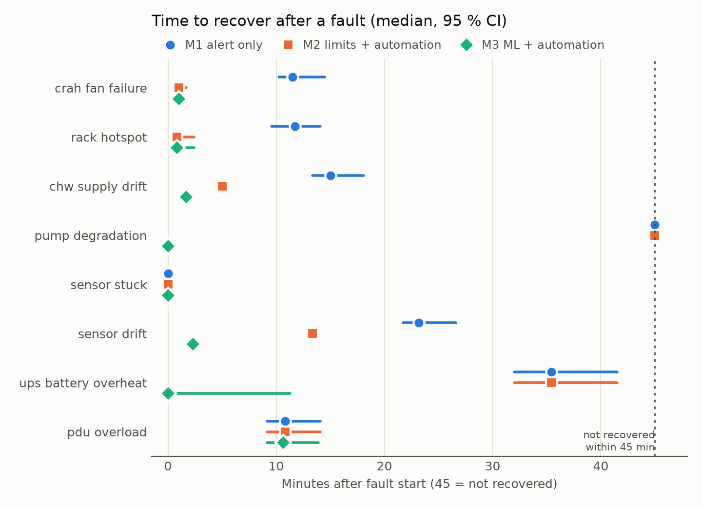
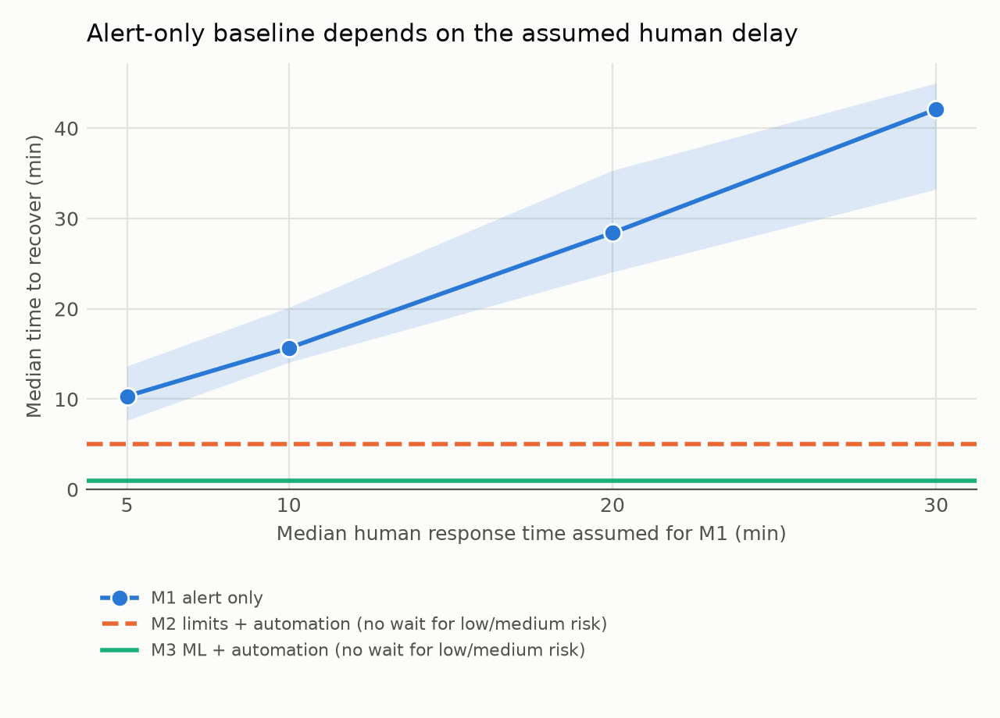
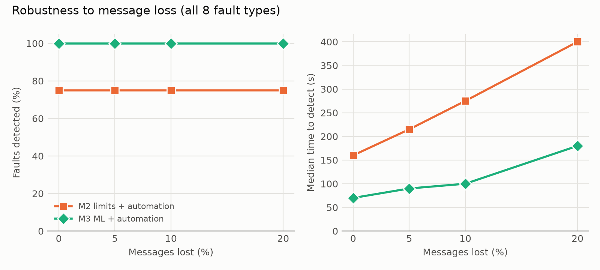
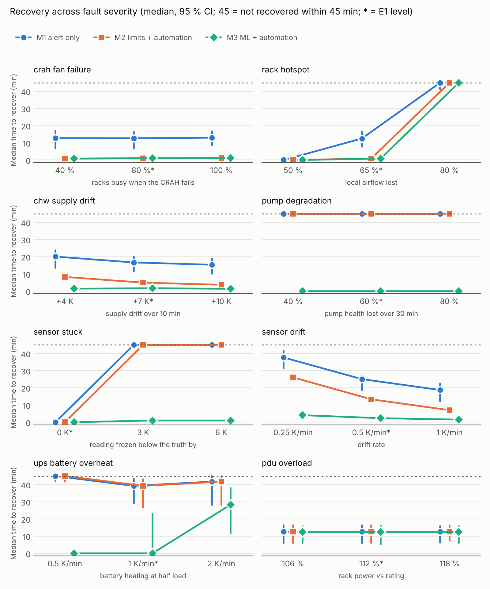
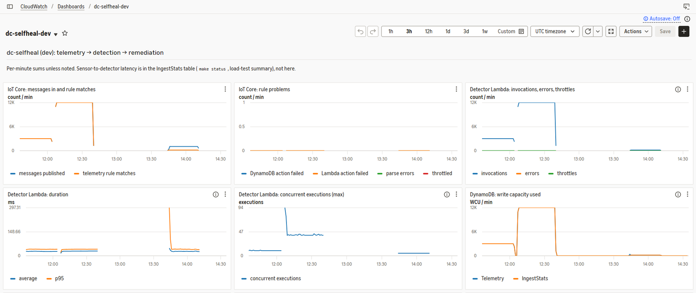

# Results

This chapter presents the results of the evaluations in the order of Table 4: the detector evaluation on simulated faults, the validation on real pump data, the closed-loop experiments E1, M1 sensitivity, E4 and E5, and the measurements of the cloud pipeline. The chapter ends with a summary of the hypotheses. The results are interpreted in Chapter 8.

## Detector evaluation

Each detector was evaluated on the eight fault types with five seeds each, without remediation, and on 24 hours of separate normal operation to count false alarms. Table 12 shows how many of the 40 faults each detector diagnosed correctly, the median time to detect, and the false alarms. Automated false alarms are false diagnoses that would have started a playbook; notify-only false alarms are *unexplained* anomalies that would only have alerted a person.

Table 12. Detector evaluation on simulated faults (8 fault types × 5 seeds)

| Detector | Faults detected | Median time to detect | Wrong automated events | Automated false alarms per day | Notify-only false alarms per day |
| --- | --- | --- | --- | --- | --- |
| D0 limits | 30/40 | 155 s | 0 | 0 | 0 |
| D1 Isolation Forest | 28/40 | 195 s | 0 | 0 | 2 |
| D2 LSTM autoencoder | 35/40 | 80 s | 0 | 0 | 1 |
| D1h hybrid | 40/40 | 75 s | 0 | 0 | 2 |
| D2h hybrid | 40/40 | 75 s | 0 | 0 | 1 |

The static limits missed two fault types entirely. Pump degradation never crossed a limit within the observation window, and a stuck sensor reported a plausible value that no limit could question. On the gradual faults, the limits were three to ten times slower than the LSTM autoencoder: sensor drift was detected after 780 seconds instead of 120 seconds, chilled-water drift after 280 instead of 90 seconds, and UPS battery overheating after 800 instead of 80 seconds. On abrupt faults, such as a CRAH failure or a rack hotspot, all detectors were equally fast at 30 seconds, which is the confirmation floor of the design.

The pure machine-learning detectors had blind spots of their own. Neither detected a stuck sensor reliably, because a frozen value inside the normal range looks normal. The Isolation Forest also missed every PDU overload, because values far outside the training range do not necessarily receive a high anomaly score from its random splits. Combining the models with the static limits and a flatline rule removed these blind spots: both hybrids detected all 40 faults. The D2h hybrid was selected for deployment because it was as fast as D1h on average, faster on pump degradation (170 s against 1,380 s), raised fewer notify-only alarms, and was less sensitive to the choice of threshold. Raising the threshold quantile from 0.999 to 0.9999 reduced notify-only false alarms from about 13–15 to 1–2 per day without slowing D2h down, whereas D1h became much slower.

## Validation on real pump data

The detectors were applied to the SKAB test set, 34 labelled experiments from a real water-pump testbed, using the benchmark's protocol. Table 13 shows the results together with two published leaderboard entries for comparison.

Table 13. Results on the SKAB test set (k = 1, pointwise scoring)

| Detector | F1 | False alarm rate | Missed alarm rate |
| --- | --- | --- | --- |
| D0 ±3σ limits | 0.76 | 44.1 % | 15.4 % |
| D1 Isolation Forest | 0.50 | 13.2 % | 63.1 % |
| D2 LSTM autoencoder | 0.77 | 55.9 % | 7.4 % |
| D1h hybrid | 0.76 | 47.3 % | 13.1 % |
| D2h hybrid | 0.77 | 58.2 % | 6.8 % |
| Leaderboard: Conv-AE (best F1) | 0.78 | 13.6 % | 28.0 % |
| Leaderboard: LSTM-AE | 0.74 | 30.0 % | 25.9 % |
| Leaderboard: Isolation Forest | 0.29 | 2.6 % | 82.9 % |

The LSTM autoencoder and the D2h hybrid reached an F1 score of 0.77, slightly above the statistical limits (0.76) and above the published LSTM autoencoder (0.74), and within 0.01 of the best published outlier detector. Their false alarm rate, however, was clearly higher than that of the limits and of the published models: they detected more of the anomalous points at the cost of more false alarms. With the three-window confirmation used in the framework (k = 3), the false alarm rate of D2h fell to 52.8 % while F1 stayed at 0.77. The Isolation Forest, as on the leaderboard, raised few false alarms but missed most anomalies.

## Remediation in the closed loop

Before the main experiments, every playbook was tested in the offline closed loop with five seeds per fault type. All 30 runs of the six low- and medium-risk fault types were mitigated and verified without human input. The median time from fault start to verified recovery ranged from 70 seconds for a rack hotspot to 240 seconds for pump degradation. All ten runs of the two high-risk fault types stopped to wait for approval without sending any command, and after a simulated operator approved them two minutes later, they were mitigated and verified within a median of 180–240 seconds. The incident grouping worked as designed: a pump or chilled-water fault produced 27–28 related anomaly events, which all joined a single incident instead of producing separate alerts.

## E1: fault response

Experiment E1 compared the three operating modes on the eight fault types with 20 paired seeds each, 480 runs in total. Table 14 shows the detection rate and the median time to recover, and Figure 14 shows the median time to recover with its confidence interval.

Table 14. E1 detection rate and median time to recover (20 runs per cell)

| Fault | Detected M1 / M2 / M3 | Median MTTR M1 (min) | Median MTTR M2 (min) | Median MTTR M3 (min) |
| --- | --- | --- | --- | --- |
| CRAH fan failure | 100 / 100 / 100 % | 11.5 | 1.0 | 1.0 |
| Rack hotspot | 100 / 100 / 100 % | 11.8 | 0.8 | 0.8 |
| Chilled-water drift | 100 / 100 / 100 % | 15.0 | 5.0 | 1.7 |
| Pump degradation | 0 / 0 / 100 % | > 45 | > 45 | 0.0 |
| Stuck sensor | 0 / 0 / 100 % | 0.0 | 0.0 | 0.0 |
| Drifting sensor | 100 / 100 / 100 % | 23.2 | 13.3 | 2.3 |
| UPS battery overheat | 100 / 100 / 100 % | 35.4 | 35.4 | 0.0 |
| PDU overload | 100 / 100 / 100 % | 10.8 | 10.8 | 10.7 |

Figure 14. Median time to recover after a fault in E1, with 95 % confidence intervals

**Effect of automation (M1 against M2).** For the four fault types that harm the hall and that the limits detect without needing approval, automation reduced the median time to recover from 11.5–23.2 minutes to 0.8–13.3 minutes. All four differences were significant after Holm correction (p < 10⁻⁶), with rank-biserial correlations of 0.97–1.00, which means that practically every automated run recovered faster than every manual run. The thermal exposure after a CRAH failure fell from a median of 641 to 17 kelvin-minutes above 27 °C, a reduction of 97 %. For the two high-risk faults, M1 and M2 did not differ, because both waited for the same simulated person.

**Effect of machine-learning detection (M2 against M3).** The ML detector made a significant difference for the four slow-developing faults (p < 10⁻⁵ after correction). Pump degradation was never detected by the limits, so M1 and M2 never recovered within 45 minutes, whereas M3 switched to the standby pump before the flow or vibration left its normal range, giving a recovery time of zero. Chilled-water drift and sensor drift were corrected about three and six times faster. For the UPS battery, faster detection meant that the approval request reached the operator about 80 seconds after the fault started instead of 13 minutes, so in most runs the battery was moved to the other UPS before it exceeded 35 °C. For abrupt faults, M2 and M3 were equally fast.

**Limits of automation.** The PDU overload took about 11 minutes to resolve in all modes. It was detected quickly by every detector, but as a high-risk action it required approval, so the human response time dominated. The stuck sensor caused no physical harm in a hall in steady operation, because the frozen value stayed within 1 K of the truth, so all modes had a recovery time of zero; the modes differed only in detection, which was 0 % with limits and 100 % with the ML hybrid.

**Safety.** No wrong action occurred in any of the 480 runs: no mode commanded equipment for a fault that had not been injected.

## Sensitivity to the human response time

Because the simulated operator's response time was an assumption, the alert-only mode M1 was repeated with median response times of 5, 10, 20 and 30 minutes on all eight fault types (320 runs). Table 15 and Figure 15 show the results.

Table 15. Alert-only response with different median human response times

| Median human response | Recovered within 45 min | Median time to recover [95 % CI] |
| --- | --- | --- |
| 5 min | 88 % | 10.3 min [7.7, 13.7] |
| 10 min | 85 % | 15.7 min [14.1, 20.2] |
| 20 min | 72 % | 28.4 min [24.1, 35.3] |
| 30 min | 57 % | 42.1 min [33.2, > 45] |
| M2, no human for low/medium risk | – | 5.0 min [4.0, 13.3] |
| M3, no human for low/medium risk | – | 1.0 min [0.8, 1.7] |

Figure 15. Time to recover in alert-only mode as a function of the human response time

Even with a fast median response of five minutes, alert-only operation took ten times longer to recover than M3. The conclusion that automation shortens recovery therefore did not depend on the assumed response time.

## E4: robustness

**Load surges.** In 20 runs per mode, all racks of one zone stood idle for 15 minutes and then started a job at the same moment, the most abrupt swing the simulator can produce. No mode sent any command, so there were no false remediations. M3 raised a median of one notify-only alert per run.

**A sensor already faulty.** In two scenarios a rack sensor had failed five minutes before a physical fault in the same zone. With a stuck sensor followed by a CRAH failure, the median time to recover was 12.7 minutes in M1 and 1.0 minute in M2 and M3. With a drifting sensor followed by chilled-water drift, it was 16.7, 4.9 and 1.7 minutes. All runs were detected and recovered, and no wrong action occurred.

**Message loss.** Table 16 shows the results when 5, 10 or 20 % of gateway messages were lost, for all eight fault types (80 runs per cell), and Figure 16 shows the time to detect.

Table 16. Detection and recovery with lost messages

| Messages lost | M2 detected / recovered | M2 median MTTD, MTTR | M3 detected / recovered | M3 median MTTD, MTTR |
| --- | --- | --- | --- | --- |
| 5 % | 75 % / 85 % | 215 s, 5.8 min | 100 % / 100 % | 90 s, 1.7 min |
| 10 % | 75 % / 85 % | 275 s, 7.4 min | 100 % / 100 % | 100 s, 1.8 min |
| 20 % | 75 % / 82 % | 400 s, 13.6 min | 100 % / 99 % | 180 s, 3.4 min |

Figure 16. Time to detect with 5–20 % of messages lost

With 20 % of messages lost, the ML hybrid still detected every fault. Detection became slower because a gap in a gateway's sequence restarts its 90-second history window. The share of M2 detections stayed at 75 % because the limits never detect two of the eight fault types. No wrong action occurred in any of the 600 robustness runs.

## E5: severity

Experiment E5 repeated every fault type at three severity levels, from milder to harsher than in E1, with 10 seeds per mode (720 runs). Table 17 shows the median time to recover per level and mode, and Figure 17 shows the same results with their confidence intervals.

Table 17. E5 median time to recover in minutes (M1 / M2 / M3, 10 runs per cell)

| Fault | Level 1 (mildest) | Level 2 (E1 level) | Level 3 (harshest) |
| --- | --- | --- | --- |
| CRAH fan failure | 12.8 / 0.8 / 0.8 | 12.7 / 1.0 / 1.0 | 13.0 / 1.1 / 1.1 |
| Rack hotspot | 0.0 / 0.0 / 0.0 | 12.5 / 0.8 / 0.8 | > 45 / > 45 / > 45 |
| Chilled-water drift | 20.1 / 8.2 / 1.4 | 16.7 / 4.9 / 1.7 | 15.3 / 3.7 / 1.3 |
| Pump degradation | > 45 / > 45 / 0.0 | > 45 / > 45 / 0.0 | > 45 / > 45 / 0.0 |
| Stuck sensor | 0.0 / 0.0 / 0.0 | > 45 / > 45 / 1.0 | > 45 / > 45 / 1.0 |
| Drifting sensor | 37.7 / 26.1 / 4.1 | 25.1 / 13.3 / 2.3 | 18.8 / 7.0 / 1.5 |
| UPS battery overheat | > 45 / > 45 / 0.0 | 39.2 / 39.2 / 0.0 | 41.8 / 41.8 / 28.3 |
| PDU overload | 12.6 / 12.6 / 12.5 | 12.7 / 12.7 / 12.5 | 12.6 / 12.6 / 12.5 |

The stuck-sensor levels are defined differently from the other faults: level 1 freezes the reading at its true value, as in E1, while levels 2 and 3 freeze it 3 K and 6 K below the truth, so that the frozen sensor hides a rack that is getting warmer.

Figure 17. Median time to recover across three severity levels per fault type

The ranking of the modes held at every severity level. In none of the 48 comparisons (24 fault and level cells, each comparing M1 with M2 and M2 with M3) was the later mode significantly slower than the earlier one. Automation was significantly faster than alert-only response in 10 cells and ML detection was significantly faster than static limits in 13 cells (Holm-adjusted p < 0.05); in the remaining cells the modes did not differ. The limits detected 70 % of the faults in E5 and the ML hybrid 100 %. When a stuck sensor hid a warming rack, only the ML hybrid noticed it and quarantined the sensor within about one minute, while the other modes never recovered within the observation window. No wrong action occurred in any of the 720 runs.

E5 also showed two limits of the framework. A rack hotspot with 80 % of its local airflow lost was not resolved by any mode, because the only automatic action, boosting the zone's cooling, cannot compensate for such a loss; the workload move that the playbook requests from a person is outside the automation. The fastest UPS battery overheating, 2 K per minute, exceeded the battery limit in most runs before the approval of the simulated operator arrived, even though the ML hybrid detected it within a minute. For high-risk faults that develop this quickly, the approval step sets the limit of what automation can achieve.

## Cloud pipeline: latency, scalability and cost

**Latency on the local stack.** On LocalStack, the time from a gateway publishing a message to the end of the detector run was measured at one, five and ten times the real message rate. At the real rate, the median latency was 106 milliseconds, of which detection itself took about 3 milliseconds; most of the time was spent reading the gateway's recent history from the telemetry table. At ten times the real rate the latency rose to 271 milliseconds, but after a persistence setting of the emulator was corrected it was 108 milliseconds, which shows that the increase came from the emulator rather than from the design. The pipeline kept up with the message rate at every speed, and the latency did not grow during a measurement window.

The latency from a fault to the first corrective command was dominated by detection, not by the cloud path. In E1, the median time from fault start to the first command in M3 was 30 seconds for abrupt faults, which is the confirmation floor of three 10-second windows, and 1.2–3.1 minutes for slowly developing faults.

**Live check on AWS.** The stack was deployed to AWS in the Stockholm region, and the end-to-end check was run with the simulated gateways connected to IoT Core over MQTT from an EC2 instance in the same region, at ten times the real message rate. Both scenarios passed every check. When CRAH 2 failed, the detector published the anomaly 30 simulated seconds after the fault, the cooling failover playbook started the standby unit and handed the zone back to automatic control without human input, and all rack inlets in the zone stayed below 27 °C (at most 20.8 °C). The time from the sensor message that confirmed the fault to the first command arriving at the gateway was 2.4 seconds, which covers detection, the decision in the state machine and the command through the device shadow. From a gateway publishing a message to the end of the detector run, the mean latency was 85 milliseconds and the 95th percentile at most 150 milliseconds; most of it was queueing, and detection itself took about 6 milliseconds. A shadow command made the round trip to the gateway in 254 milliseconds. In the second scenario, the UPS overheating plan waited for approval without sending any command, the email link opened the plan without deciding anything, the approval was accepted once and refused the second time, and the load was transferred to the second UPS only after the plan had been rechecked on fresh telemetry. The full output is in experiments/results/aws_e2e_check.md.

**Load test.** Table 18 shows the results of the load test on AWS IoT Core. Virtual gateways on an EC2 instance in the same region sent realistic zone telemetry, recorded from the simulator, every 10 seconds over MQTT with TLS, and each level was measured for 30 minutes after a three-minute warm-up. At 50, 500 and 2,000 gateways, which correspond to about 10, 100 and 400 data halls, the pipeline processed every message it received; the difference between messages sent and processed was within ±0.01 %, which is explained by messages in flight at the edges of the measuring window. The latency from a gateway publishing a message to the end of the detector run did not change with the load: the 50th and 95th percentiles were at most 100 milliseconds and the 99th percentile at most 150 milliseconds at every level. About 6 milliseconds of this was spent between the gateway and IoT Core, about 60 milliseconds between IoT Core and the start of the Lambda function, and about 12 milliseconds inside the detector. No Lambda or DynamoDB request was throttled and no IoT rule action failed. During the measuring window at 2,000 gateways, at most 43 detector instances ran at the same time, against an account limit of 400.

Table 18. Load test on AWS (eu-north-1): 30 minutes per level, one message per gateway every 10 seconds

| Gateways | Messages/s sent | Messages/s processed | p50 / p95 / p99 latency (ms) | Peak concurrent Lambdas | Throttles | Rule failures |
| --- | --- | --- | --- | --- | --- | --- |
| 50 | 5.0 | 5.0 | ≤ 100 / ≤ 100 / ≤ 150 | 1 | 0 | 0 |
| 500 | 50.0 | 50.0 | ≤ 100 / ≤ 100 / ≤ 150 | 11 | 0 | 0 |
| 2,000 | 200.0 | 200.0 | ≤ 100 / ≤ 100 / ≤ 150 | 43 | 0 | 0 |

The CloudWatch dashboard of the deployment confirms these figures (Figure 18). IoT Core received and matched about 3,000 messages a minute at 500 gateways and 12,000 at 2,000, no rule action failed, and the detector reported no errors or throttles. It also shows what the measuring window excluded: at the start of the 2,000-gateway level, while new function instances were being started, up to 94 detector instances ran at the same time before the number settled at about 43.

Figure 18. CloudWatch dashboard of the deployment: the load test at 500 and 2,000 gateways (until about 12:45 UTC) and the live demonstrations (after 13:40 UTC)

At the measured average detector duration of 29 milliseconds, 10,000 gateways (1,000 messages per second) would need about 29 concurrent executions in a steady state, and scaling the measured steady-state peak linearly gives about 215, both within the limit of 400. A start-up burst scaled in the same way, however, would exceed the limit, so at that scale the detector would need reserved concurrency or a higher quota, or the gateways would have to reconnect gradually. The full results are in experiments/results/e2_summary.md.

**Cost.** Table 19 shows the monthly cost estimated by the cost model for one, ten and one hundred data halls, using list prices for the Stockholm region and the usage per message measured in the load test at 2,000 gateways: an average detector run of 29 milliseconds with 512 MB of memory, one write unit per message in each of the two tables written and about one read unit per history query. Every gateway sends one message every 10 seconds, and five automated and 30 notify-only incidents per hall and month were assumed.

Table 19. Estimated monthly AWS cost (USD, list prices, usage measured in the load test)

| Service | 1 hall | 10 halls | 100 halls |
| --- | --- | --- | --- |
| IoT Core (messages, rule, actions, shadows) | 1.90 | 18.97 | 189.66 |
| Lambda (detector and remediation) | 0.57 | 5.69 | 56.93 |
| DynamoDB on demand (requests and storage) | 2.27 | 22.67 | 226.69 |
| Step Functions, EventBridge, SNS | 0.01 | 0.10 | 0.99 |
| CloudWatch Logs | 0.24 | 2.40 | 24.04 |
| Total | 4.98 | 49.83 | 498.30 |
| Total after the always-free allowances | 3.75 | 39.30 | 482.56 |
| Per rack | 0.25 | 0.25 | 0.25 |

One hall with 20 racks would cost about $5 a month at list price, or $0.25 per rack, and the cost grows linearly with the number of halls. With the default usage figures used before the load test, the model had estimated $0.32 per rack; the measured detector runs were shorter than assumed. DynamoDB was the largest item. With provisioned capacity sized to the load instead of on-demand billing, the DynamoDB request cost of one hall fell from $1.78 to $1.04 per month, and within the always-free capacity it fell to zero for up to ten halls. Remediation itself, the Step Functions workflow and the notifications, cost almost nothing, because faults are rare compared with telemetry messages.

[Step 8, to be completed: the measured AWS bill for the test period compared with the cost model (Cost Explorer, make aws-bill). Source file: experiments/results/e3_measured.md.]

## Summary of the hypotheses

Table 20 summarises the outcome of each hypothesis.

Table 20. Outcome of the hypotheses

| # | Hypothesis | Result | Outcome |
| --- | --- | --- | --- |
| H1 | Automation shortens recovery | 4 of 4 limit-detectable harmful faults faster, p < 10⁻⁶, r ≥ 0.97; ranking held at all severity levels (E5) | Pass |
| H2 | ML detects more faults, slow ones earlier | 8 of 8 fault types detected; 4 slow faults faster, p < 10⁻⁵ | Pass |
| H3 | ML adds no false actions | 0 automated false actions; 1 notify-only alert per day | Pass (criterion post hoc) |
| H4 | Detection generalises to real data | F1 0.77 against 0.76 for limits and 0.78 best published; higher false alarm rate | Pass on F1, with a limitation |
| H5 | Guardrails keep automation safe | 0 wrong actions in all 2,120 runs; every guardrail tested; approval shown end to end on the local stack and on AWS | Pass (criterion post hoc) |
| H6 | The cloud path adds only seconds | AWS live check: 2.4 s from sensor message to first command; load test: gateway to detector p95 ≤ 100 ms at up to 2,000 gateways | Pass |
| H7 | The design scales | 50, 500, 2,000 gateways: p95 ≤ 100 ms, all messages processed, 0 throttles; 43 concurrent Lambdas in steady state, 94 at start-up, limit 400 | Pass |
| H8 | Running cost is small | Model with measured usage: $0.25 per rack per month | Pass on cost per rack; bill comparison open |
