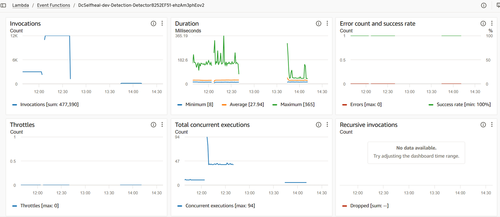
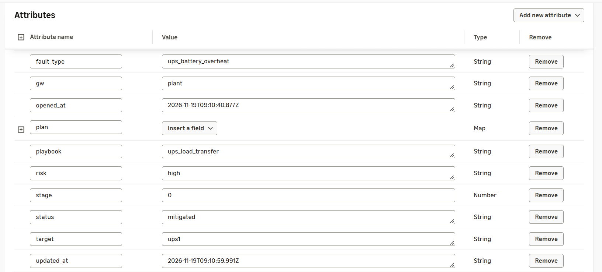
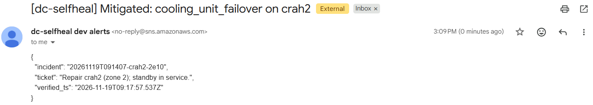
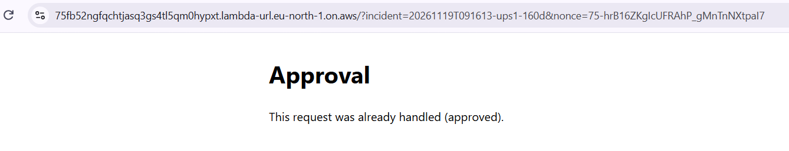
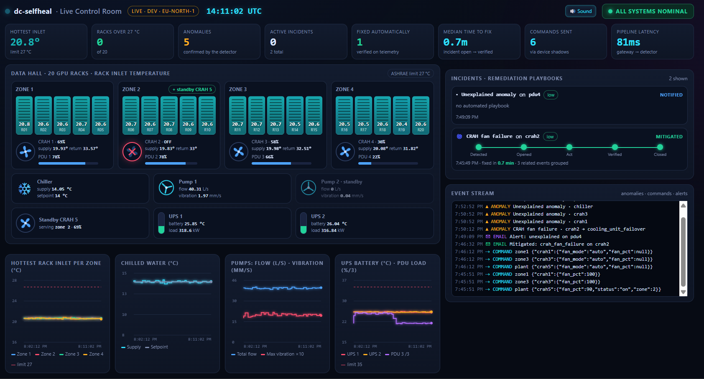

# Appendix 3: Screenshots of the AWS deployment

The screenshots were taken on 19 November 2026 in the Stockholm region (eu-north-1). Account identifiers and personal email addresses are not shown.

Figure 16. Monitoring of the detector function during the load test and the live demonstrations: 477,390 invocations without errors or throttles

{width=14}

Figure 17. Summary record of the UPS overheating incident in the DynamoDB incident table, with its playbook, risk tier, status and timestamps

{width=13}

Figure 18. Email sent through Amazon SNS after the cooling failover had been verified, with the repair ticket for CRAH 2

{width=12}

Figure 19. The approval link opened a second time: the one-time link is refused because the request was already approved

Figure 20. The live dashboard about 20 minutes after the cooling failover: the incident is mitigated, and the detector has raised notify-only alerts for unexplained anomalies on other assets
